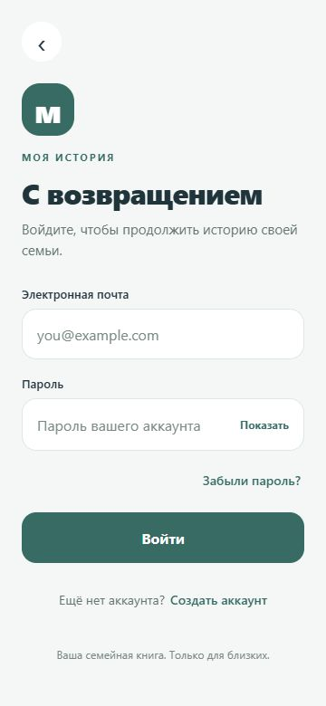
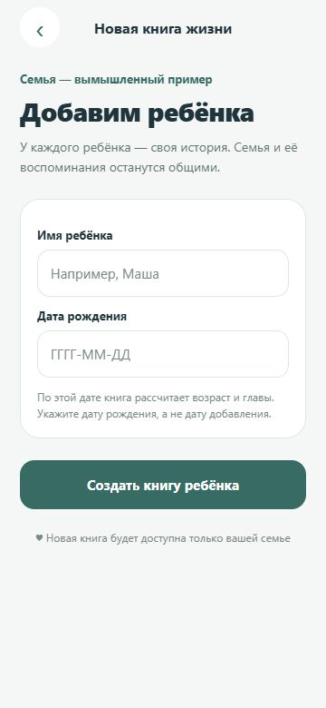

# «Моя история» — семейный архив и книга жизни ребёнка

Личный проект Вадима Смирнова: мобильное приложение, в котором семья сохраняет фотографии, видео, голосовые воспоминания и записи о важных событиях.

**Статус на 15 октября 2026:** прототип в разработке. Текущие исходники, тесты и документация синхронизированы с GitHub; готового публичного релиза и APK для самостоятельной установки пока нет. Известная ошибка открытия капсулы на Android ещё не исправлена. [Актуальный аудит и план подготовки к выпуску](docs/READINESS_AUDIT_2026-10-14.md).

## Посмотреть проект

| Вход | Создание книги ребёнка |
| --- | --- |
|  |  |

Настоящие снимки веб-версии в мобильном размере. Формы показаны без данных пользователя. Это иллюстрация интерфейса текущей разработки, а не подтверждение готовности Android-релиза.

## Задача продукта

Собрать семейные воспоминания в одном месте: отдельная история ребёнка, галерея, дневник и материалы, к которым можно возвращаться через годы.

## Над чем работаю

- Вход, регистрация, семья и профили детей.
- Семейная галерея фотографий и видео.
- Дневник: первые слова, умения и тёплые моменты.
- Голосовые воспоминания и приглашения близких.
- Редактирование и восстановимая корзина.
- Отдельная «Капсула времени»: письма и материалы ребёнку в будущее; раздел дорабатывается.

В этом снимке опубликована текущая рабочая реализация, включая исходники, тесты, SQL-сценарии и отчёты. Отдельные мобильные сценарии ещё проверяются. Это сохранение накопленной разработки, а не объявление готовности к публикации. Материалы портфолио и прежняя история коммитов сохранены.

## Технологии и мой вклад

React Native, Expo, TypeScript, Expo Router и Supabase. В текущей разработке используются авторизация, база данных и хранилище файлов.

Развиваю продуктовую идею, уточняю структуру и пользовательские сценарии. С помощью AI-инструментов работаю над интерфейсом, кодом и проверками. Прохожу сценарии как пользователь, уточняю поведение при ошибках и учусь понимать архитектуру и права доступа к семейным материалам.

## Как показать на собеседовании

1. Открыть эту страницу: задача, технологии и снимки интерфейса.
2. Посмотреть структуру опубликованного кода и [описание архитектуры](ARCHITECTURE.md).
3. На демонстрации экрана пройти проверенные сценарии рабочей версии: вход, профиль ребёнка, галерея и дневник.
4. «Капсулу времени» обозначить как дорабатываемую часть. Не представлять прототип как готовый релиз.

## Запуск опубликованного снимка

```bash
npm ci
npx expo start
```

Для серверных функций нужен собственный тестовый проект и настройки его окружения. Клонирование кода не предоставляет доступ к семейному архиву автора. Совместимость установленного клиента Expo нужно сверять с SDK в `package.json`.

Контакт: [@PythonDeveloperML](https://t.me/PythonDeveloperML).

Другие проекты: [«Линия»](https://github.com/vadim291293/liniya-studio-demo-bot) · [«Мой AI-редактор»](https://github.com/vadim291293/ai-news-agent-portfolio).

---

## Настройка Supabase

Для клиента нужны `EXPO_PUBLIC_SUPABASE_URL` и `EXPO_PUBLIC_SUPABASE_PUBLISHABLE_KEY` в локальном `.env.local`. Публикуемый ключ не заменяет RLS. Никогда не добавляйте `service_role` key в приложение или репозиторий.

Схема воспоминаний и приватного хранилища описана в [`supabase/setup/README.md`](supabase/setup/README.md); согласованный SQL-сценарий уже применён к живому проекту. В Data API открыт только необходимый приложению allowlist, а доступ к строкам ограничивается RLS.

## Текущие возможности

- личные капсулы создателя семьи: письмо, фото, видео и голос; отдельный пароль или явный опциональный вход по strong-биометрии, показать/скрыть пароль, страницы списка, редактирование и закрытая корзина; без замка до 18 лет;
- регистрация, вход, восстановление сессии и выхода;
- создание семейной истории с ребёнком;
- добавление следующих детей в существующую семью с защитой от повторной отправки;
- главный экран семьи и профиль ребёнка;
- добавление текстового воспоминания, даты события и до пяти фото/видео;
- восстановление прерванного выбора Android-галереи и полей формы только в исходном аккаунте/семье;
- дата съёмки фото из доступного EXIF с ручным исправлением;
- полноэкранный просмотр сохранённых фото по нажатию;
- галерея без возрастных глав и месячных обложек; общий выбор ребёнка и отдельные Фото/Видео;
- нижняя навигация «Фото / Видео / Добавить / Записи / Семья»; дневник первых слов, новых умений, смешных фраз и тёплых моментов, фото/видео только для новых умений, необязательный голос;
- реальные кадры обложек видео с повтором при ошибке, обновление жестом вниз и подгрузка;
- полноэкранное фото со свайпом/zoom и отдельный видеопросмотр; возраст — подпись, не меню возрастных глав.

Актуальная проверка 12 октября: 462/462 локальных теста, TypeScript, static render, Android JS/Hermes export. Это не APK и не проверка физического отпечатка/телефона. Подробности входа, сохранности и ограничения: [`docs/CAPSULE_BIOMETRY_VERIFICATION.md`](docs/CAPSULE_BIOMETRY_VERIFICATION.md). После установки native зависимостей перезапустить Metro из основного проекта с `npx expo start -c`. На iOS Expo Go биометрия отключена, используется пароль; для native-конфигурации нужна отдельная сборка. Старые отчёты ниже — исторические проверки, не финальный список функций.

С отдельного разрешения владельца пройдена 51 проверка живого API на двух тестовых аккаунтах: приватность семей/файлов, запрет чужих записей, идемпотентный setup, выход и повторный вход. Тестовые данные сохранены, существующие записи не менялись. Отчёт: [`docs/LIVE_SUPABASE_VERIFICATION.md`](docs/LIVE_SUPABASE_VERIFICATION.md). Это не проверка нативного интерфейса или входа конкретного владельца.

Проверки без установки новых пакетов: `npm test` и `npm run typecheck`. План ручной проверки: [`docs/SMOKE_TEST.md`](docs/SMOKE_TEST.md). Актуальное состояние и ограничения: [`CURRENT_STATE.md`](CURRENT_STATE.md).

Первая переработка интерфейса, новые фотожесты и границы проверок: [`docs/INTERFACE_REVIEW.md`](docs/INTERFACE_REVIEW.md). Команда статической проверки без реального API: `node scripts/check-interface-render.cjs`.

Укрепление загрузки фото/видео, этапы сохранения и защиты смены аккаунта: [`docs/MEDIA_UPLOAD_VERIFICATION.md`](docs/MEDIA_UPLOAD_VERIFICATION.md). Supabase на этом этапе не менялся; телефонные сценарии ещё требуют проверки.

Полноэкранное видео, остановка при закрытии/фоне и защита поздних событий фото: [`docs/MEDIA_VIEWER_VERIFICATION.md`](docs/MEDIA_VIEWER_VERIFICATION.md).

Восстановление прерванного выбора Android-галереи, поля формы и границы crash recovery: [`docs/PICKER_RECOVERY_VERIFICATION.md`](docs/PICKER_RECOVERY_VERIFICATION.md). Это не автосохранение всех черновиков и не гарантия восстановления при любом завершении процесса.
